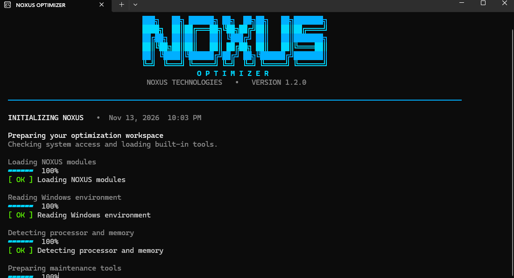

# NOXUS Optimizer

**A Windows optimization and system maintenance toolkit.**

NOXUS Optimizer brings useful PC maintenance tools together in one clean terminal-based application.

## Features

- Quick Optimize
- Temporary File Cleaner
- DNS Cache Cleanup
- Windows Gaming Mode
- Power Plan Manager
- Startup Application Review
- Windows System Repair (SFC / DISM)
- Drive Analysis and Optimization
- Disk Check (CHKDSK)
- Microsoft Defender Quick Scan
- Recycle Bin Cleaner
- System Restore Point Creation
- System Information
- Optimization History

## Requirements

- Windows 10 / Windows 11
- Python 3.10 or newer (for Python version)
- Administrator permissions for certain features

## Installation

Install the required dependency:

```bash
py -m pip install psutil
```

Run the Python version:

```bash
py NOXUS_Optimizer.py
```

## Download

You can download the standalone Windows executable from the **Releases** section of this repository.

No Python installation is required to run the compiled EXE.

## Disclaimer

NOXUS Optimizer uses built-in Windows utilities for system maintenance and repair. Some features require administrator permissions. Always review confirmation prompts before performing system changes.

Performance improvements vary depending on your hardware and system configuration.

---

**NOXUS TECHNOLOGIES**

*Software. Utilities. Digital Tools.*
